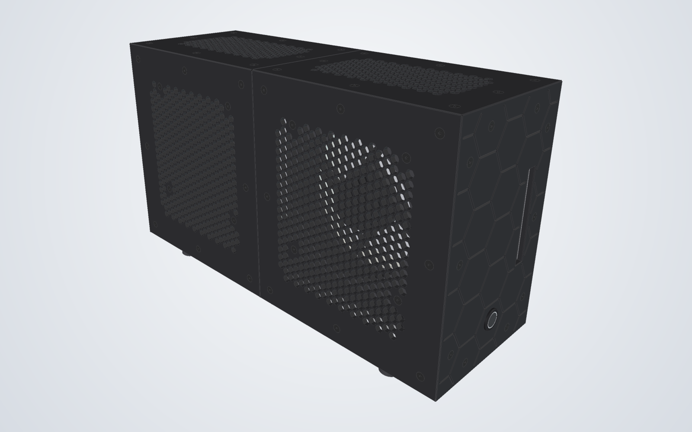
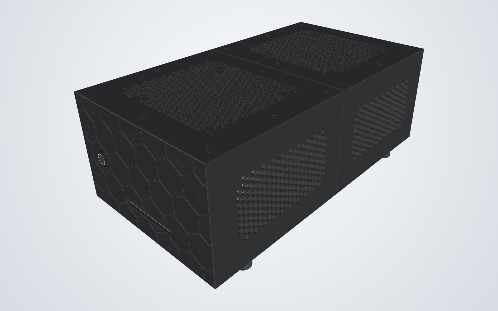

# The Fish Tank

The Fish Tank is a case for the AMD BC-250 board. Use it to make a Linux Steam Machine. It has a
frame of 2020 aluminium extrusions and 3D-printed panels. The name comes from the Cyan Skillfish
chip on the board.

| Standing | Lying flat |
|---|---|
|  |  |

- **Cooling.** Two 120×25 mm ARCTIC P12 Pro fans push and pull air through the heatsink. Printed
  shrouds attach to the BC-250 and send the air through the heatsink. A 120×15 mm Thermalright
  TL-C12015B fan blows air onto the backplate.
- **Two positions.** The case can stand upright or lie on its right side. Install the TPU feet on
  the bottom or on the right side. When the case lies on its side, the push-pull fans point up.
  The backplate fan then pulls air from below the case.
- **Frame.** The frame is a box of 2020 aluminium extrusions with blind joints. The panels and the
  other printed parts attach to it with screws into T-nuts.
- **Appearance.** The panels meet at 45° mitres, so the case has sharp square corners. The grills
  are hex holes in the panels, symmetrical on each panel. The front has a hex pattern in its
  surface. All screws on the outer surface are flush.
- **Easy to print.** No part has supports. No overhang is more than 65°. All edges on the print
  bed have chamfers. Each STL file has the correct orientation for printing.
- **Hard mounting.** M3 screws in heat-set inserts (M3x5x4) or in T-nuts hold all the parts. TPU parts
  isolate the fans.

> [!WARNING]
> **Work in progress.** Examine the fit of each part before you use this design. The board parts
> are printed. The enclosure parts are not printed or assembled yet. AI tools helped to write the
> scripts that make the design. When the design is complete, the documents will have photos and
> the design will have a 1.0 release.

## Documentation

- [`BOM.md`](BOM.md): the parts to buy.
- [`stls/README.md`](stls/README.md): the parts to print, and how to print them.
- [`stls/ASSEMBLY.md`](stls/ASSEMBLY.md): the assembly procedure (not complete).
- [`renders/README.md`](renders/README.md): all the renders of the case.

## Building

Python scripts make all the CAD files. The scripts run in FreeCAD. The build makes the FreeCAD
files, the STL files, the renders, and `BOM.md`. To update all the files that are out of date,
use `make`.

```sh
make            # make all the files: cad/*.FCStd, stls/, the assembly, renders/, and BOM.md
make parts      # make only the printed parts (no FreeCAD GUI and no BC-250 model)
make clean      # remove all the files that the build makes
```

**Necessary items:**
- **FreeCAD 1.1.** If FreeCAD is not on your `PATH`, use
  `make FREECADCMD=/path/to/freecadcmd FREECAD=/path/to/freecad`.
- **A display.** The assembly step uses the FreeCAD GUI. If there is no display, `make` uses
  `xvfb-run`.
- **The BC-250 model.** Download the STEP file "Accurate 3D model of the AMD BC-250 board" by
  torassk ([Printables 1341336](https://www.printables.com/model/1341336)). Save it as
  `cad/step/bc250.step`, or set `BC_STEP=` to its path.
  - The licence of this model does not permit redistribution. Because of this, git does not
    contain the model or the `cad/bc250_board.FCStd` file that the build makes from it.
  - If the file is missing, `make` stops and shows these instructions.
- **Included:** the Noctua NF-A12x25 model by djos_1475 (Printables 273355, public domain), as
  `cad/step/nf-a12x25.step`. The build uses it as a model of the P12 Pro. The two fans have the
  same frame size and hole pattern.
- **Optional:** to use a STEP file of the slim fan, set `SLIM_FAN_STEP=`. If you do not set it,
  the build uses a simplified model.

**Checks that `make` does.** If one of these checks fails, the build stops. The log in `logs/`
shows the cause.
- Each body is one valid solid, and its sketches are fully constrained.
- Each STL file is on the print bed and has no overhang of more than 65°.
- The hex pattern removes the correct volume.
- Each part fits on a 250 × 250 mm print bed.

The assembly step also finds the parts that overlap and shows them.

**Changes to the design.** Each part has a `Params` spreadsheet. The spreadsheet controls the
sketches, so you can change the values in FreeCAD.
- **Make permanent changes in the scripts.** When `make` runs again, it replaces the files in
  `cad/`.
- **After a dimension change, run `make` again.** The spreadsheet controls the board parts and the
  back brace. The script calculates the other enclosure parts (for example, the panels) only when it
  runs. They do not change when you change the spreadsheet.

**Locked parts.** Some parts are printed and in use, and the extrusions are bought.
`cad/locked.json` keeps the size and shape of each of these parts. If a change to the scripts
changes a locked part, the build stops and shows the change. This also applies when the part
changes because of a shared parameter.
- To accept the change to a locked part, use `make relock PARTS=<file>.stl`.
- To accept the changes to all the locked parts, use `make relock`.
- To lock more parts, use `make relock PARTS=<file>.stl,<file>.stl`.

## Credits

- The BC-250 I/O and M.2 boxes use dimensions from BC250.scad by Fahad_Alduraibi
  (Printables 1651082, CC BY-SA).
- The 120 mm fan model is a Noctua NF-A12x25 by djos_1475 (Printables 273355, public domain). The
  assembly uses it as a model of the ARCTIC P12 Pro.

## Licence

Copyright © 2026 Will Ridgers. The Fish Tank has the
[GNU General Public License v3.0](LICENCE.md). You can use, change, and sell the design. If you
distribute a design that comes from this design, you must use the same licence. You must also
include its source (the scripts).

The BC-250 board model is not part of this repository. It has its own licence.
