# Renders

Generated by scripts/build_assembly.py from the assembly (cad/fish_tank.FCStd).

## Standing

| Front left | Back right |
|---|---|
| 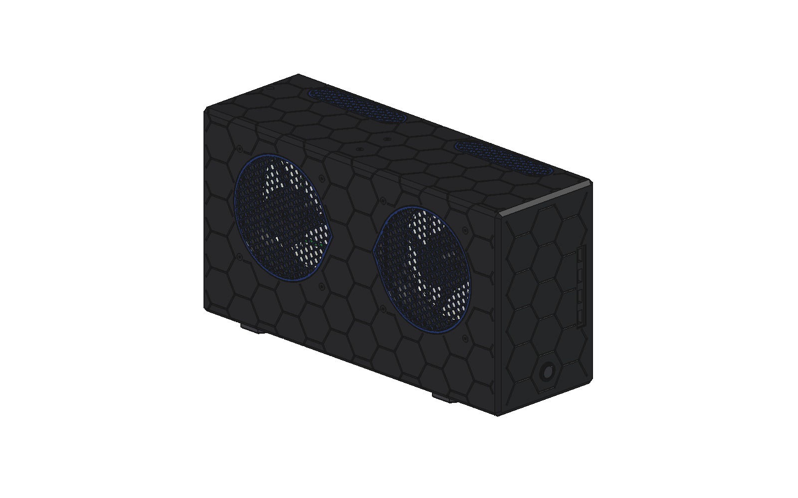 | 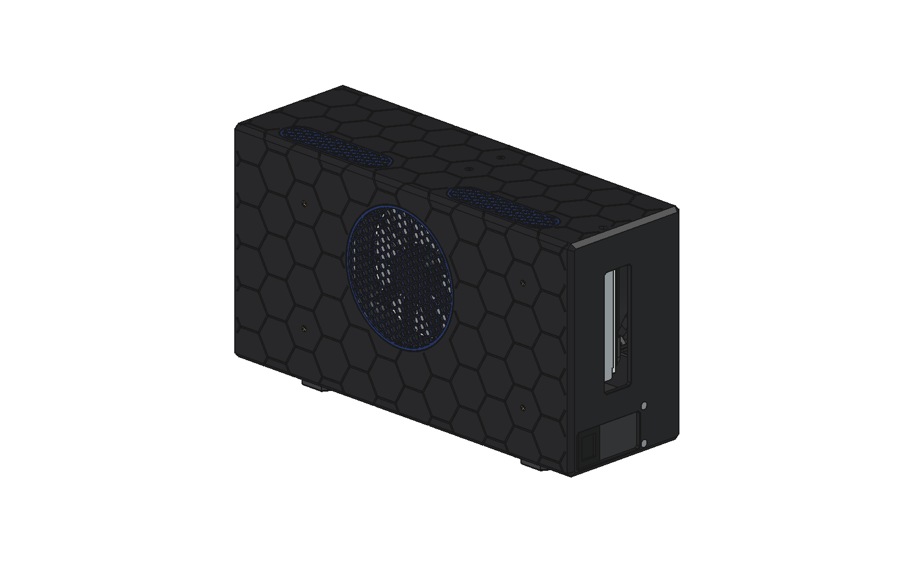 |

| Front | Back |
|---|---|
| 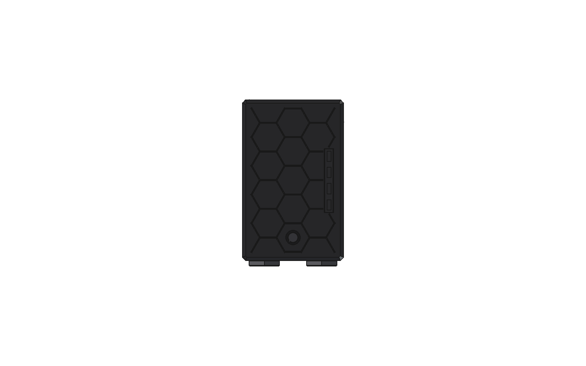 |  |

| Left | Right |
|---|---|
| 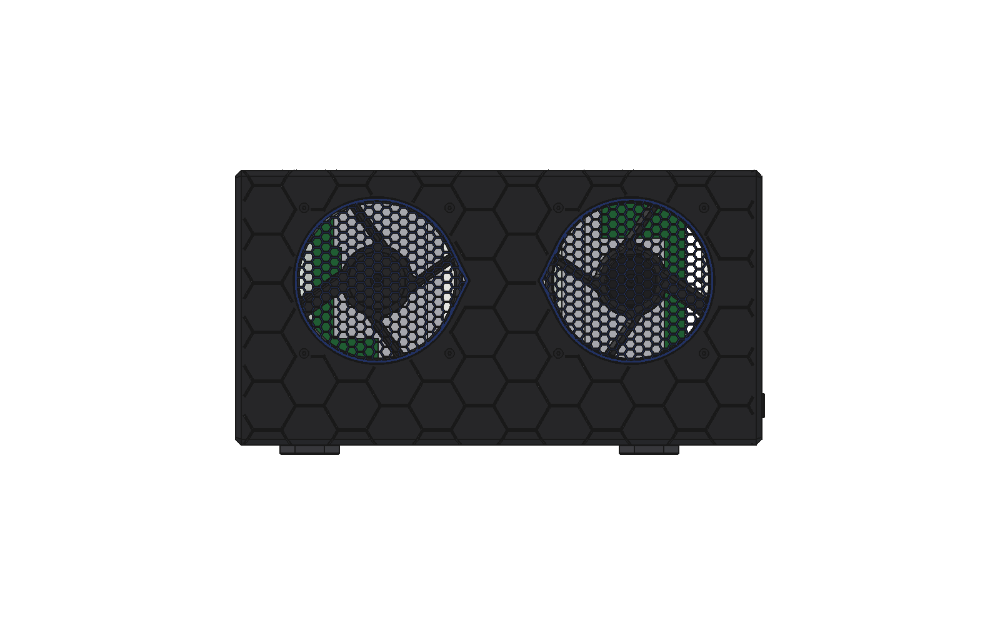 |  |

| Bottom |
|---|
| 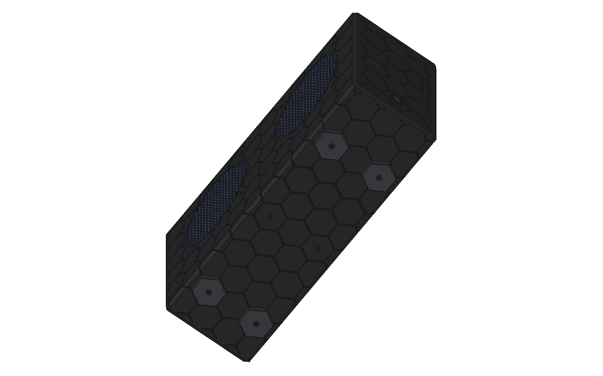 |

## Lying flat

| Front | Side |
|---|---|
| 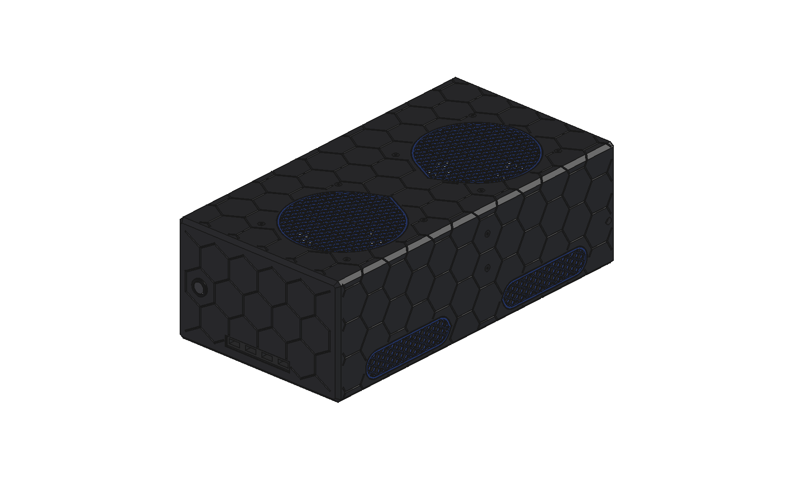 |  |

## Inside

These views hide the case and the grills.

| Front left | Top |
|---|---|
| 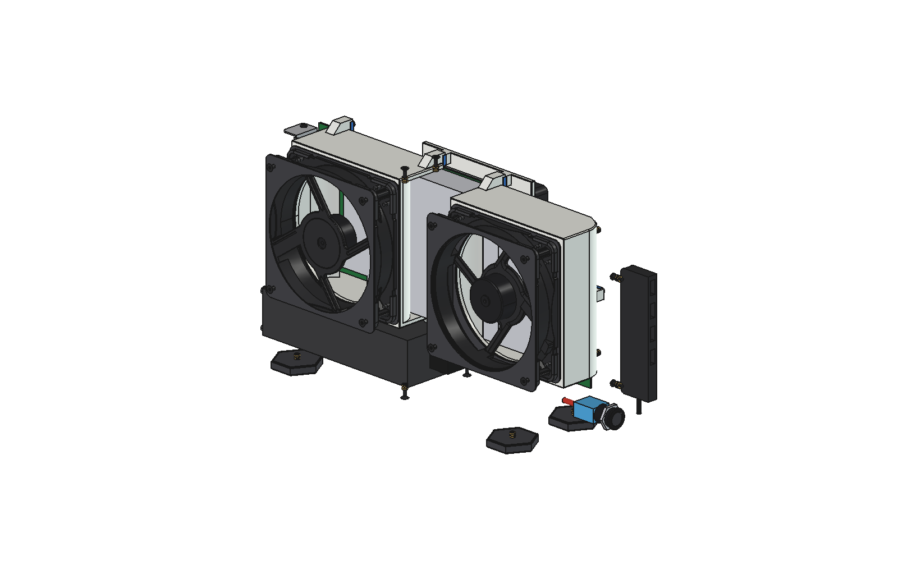 | 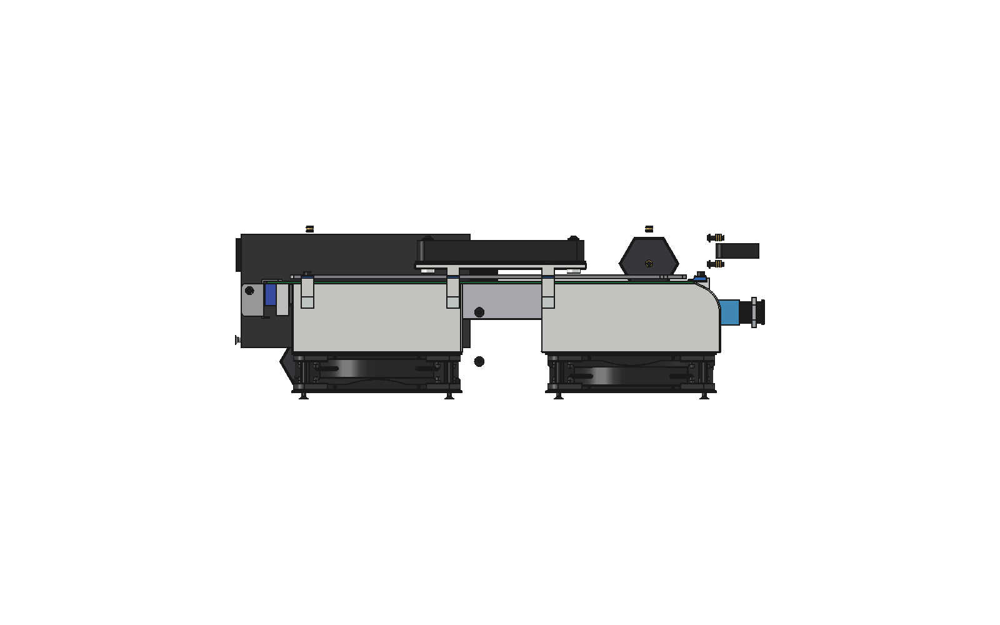 |

| Push fan end | Pull fan end |
|---|---|
| 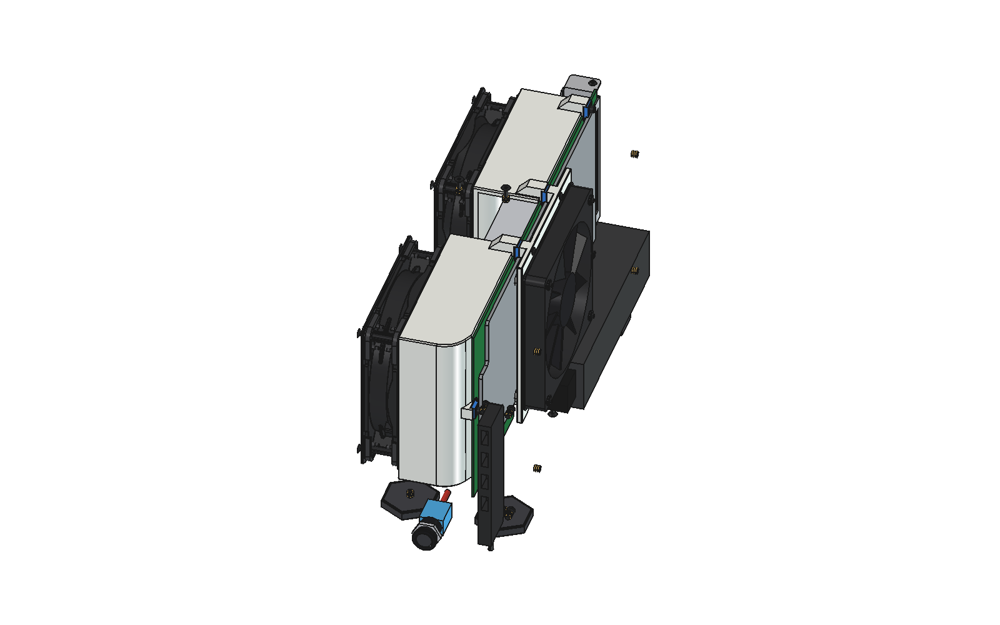 | 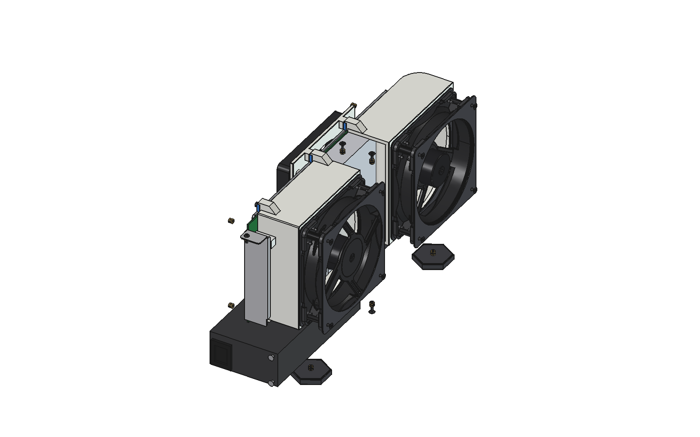 |

| Backplate side |
|---|
| 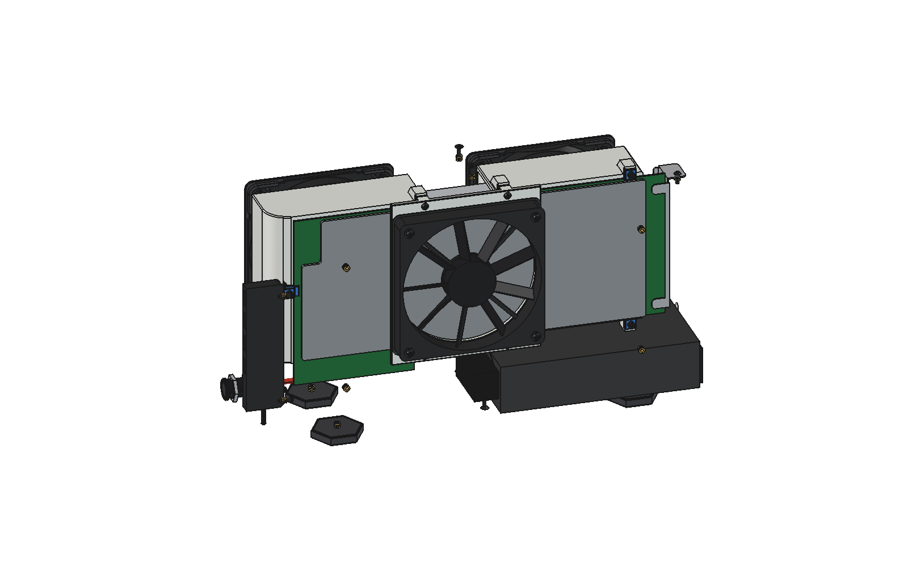 |
