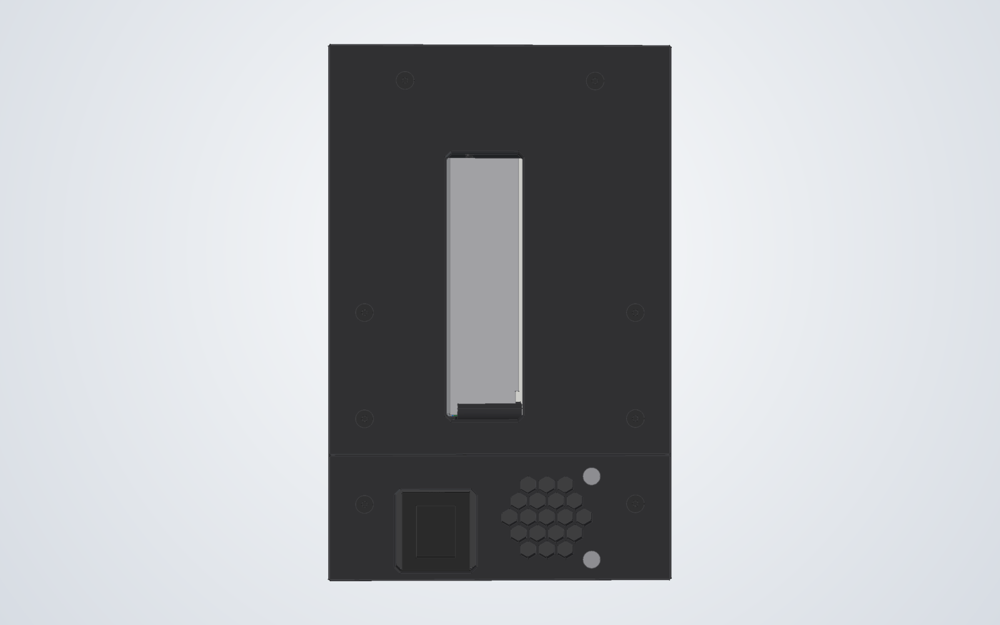
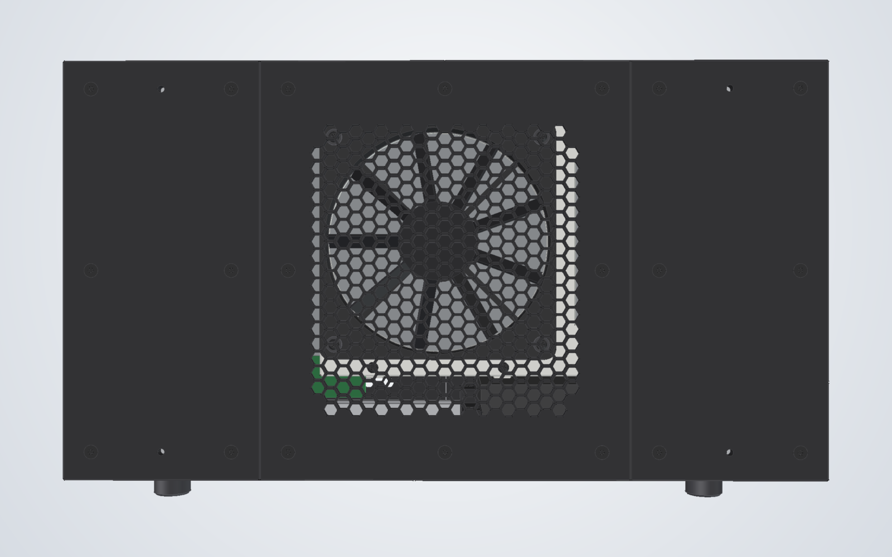
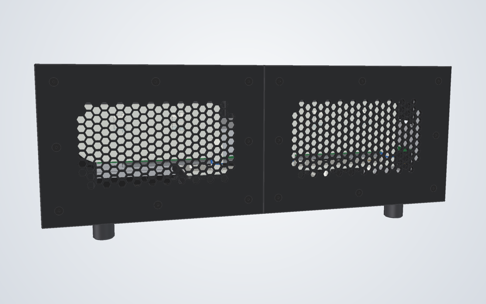
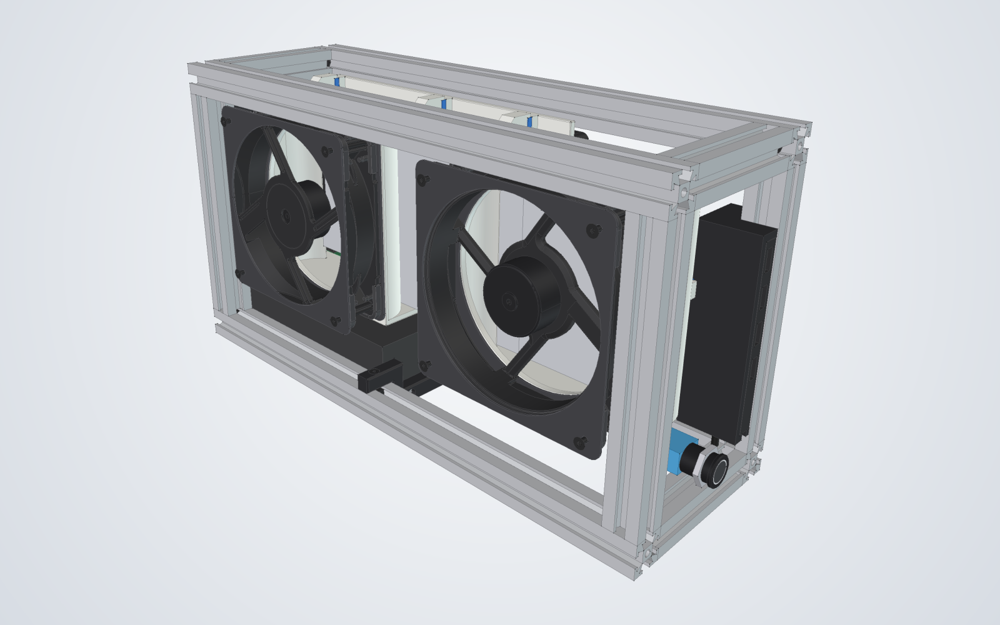
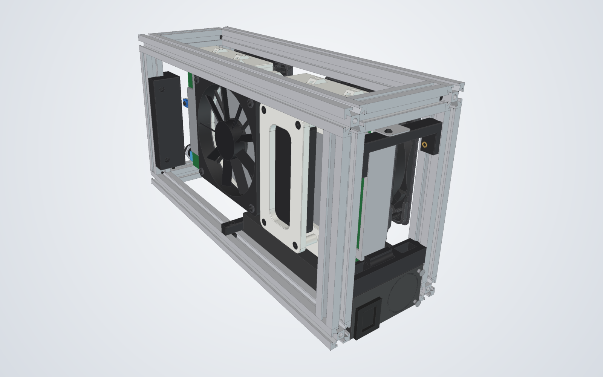

# Renders

The script scripts/build_assembly.py makes these images from the assembly (cad/fish_tank.FCStd).

## Standing

| Front left | Back right |
|---|---|
|  |  |

| Front | Back |
|---|---|
|  |  |

| Left | Right |
|---|---|
|  |  |

## Lying flat

| Front | Side |
|---|---|
|  |  |

## Frame

These views do not show the panels.

| Front left | Back right |
|---|---|
|  |  |
